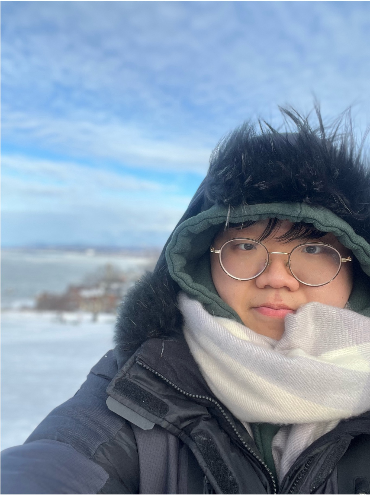

<!doctype html>
<html lang="en">
<head>
  <meta charset="utf-8">
  <meta name="viewport" content="width=device-width, initial-scale=1">
  <title>Junsung Kim</title>
  <meta name="description" content="Junsung Kim, M.S. student at GIST working on vision–language models and mixture-of-experts. Open to Research Engineer roles; graduating February 2027.">
  <meta name="author" content="Junsung Kim">
  <link rel="canonical" href="https://clementkim.github.io/">
  <meta property="og:type" content="profile">
  <meta property="og:title" content="Junsung Kim (김준성)">
  <meta property="og:description" content="M.S. student at GIST working on vision–language models and mixture-of-experts. Open to Research Engineer roles; graduating February 2027.">
  <meta property="og:url" content="https://clementkim.github.io/">
  <meta name="color-scheme" content="light dark">
  <meta name="theme-color" content="#ffffff" media="(prefers-color-scheme: light)">
  <meta name="theme-color" content="#0e1116" media="(prefers-color-scheme: dark)">
  <link rel="icon" href="data:image/svg+xml,%3Csvg xmlns='http://www.w3.org/2000/svg' viewBox='0 0 64 64'%3E%3Crect width='64' height='64' rx='14' fill='%230a5bb5'/%3E%3Ctext x='32' y='42' font-family='Georgia,serif' font-size='28' font-weight='700' text-anchor='middle' fill='white'%3EJK%3C/text%3E%3C/svg%3E">
  
  
</head>
<body>
  

    <header class="intro">
      

        <h1>Junsung Kim김준성</h1>
        

          M.S. student in Electrical Engineering and Computer Science 
          <a href="https://www.gist.ac.kr/">GIST</a> · INFONET Lab · Gwangju, South Korea
        

        <nav class="links" aria-label="Contact and profiles">
          <a href="mailto:wnstjd123@gm.gist.ac.kr">Email</a>
          <a href="Junsung_Kim_CV.pdf">CV</a>
          <a href="https://github.com/ClementKim">GitHub</a>
          <a href="https://www.linkedin.com/in/ClementKim">LinkedIn</a>
        </nav>
      

      

        JK
        <!-- To show a photo, add a square image named profile.jpg next to this file. -->
        
      

    </header>

    

      <strong>Open to Research Engineer roles</strong> in multimodal and vision–language AI.
      I graduate in February 2027. <a href="mailto:wnstjd123@gm.gist.ac.kr">Get in touch</a>
    

    <main>
      <section id="about" aria-labelledby="about-h">
        <h2 id="about-h">About</h2>
        

          I'm an M.S. student in Electrical Engineering and Computer Science at the Gwangju Institute of Science and
          Technology (GIST), working in the INFONET Lab with Prof. Heung-No Lee. My research is on
          <strong>vision–language learning and visual reasoning</strong>, with a focus on
          <strong>interaction-conditioned mixture-of-experts</strong>: using image–text interactions to weight experts
          inside a model, and analyzing what that routing actually learns. I've also worked on
          <strong>hyperspectral imaging</strong> for face anti-spoofing and identification.
        

        

          My work covers both modeling and engineering, from designing vision–language connectors to building data
          pipelines and multi-GPU training with LoRA and BF16 on A100s. Before GIST, I studied Software and Computer
          Science, and Political Science and Diplomacy, at Ajou University.
        

      </section>

      <section id="news" aria-labelledby="news-h">
        <h2 id="news-h">News</h2>
        <ul class="rows news">
          <li>2026Our paper on retrieval-augmented generation for interpreting Korean Minhwa folk art was accepted to the ORACLE Workshop at EMNLP 2026.</li>
          <li>Feb 2026Three papers at the KICS Winter Conference, including my first-author paper on hyperspectral face anti-spoofing with a CNN-MoE.</li>
          <li>Apr 20252nd place at the AI Agent &amp; Blockchain Innovation Challenge (The Academic Frontier 2025).</li>
          <li>2025Started my M.S. at GIST with a Korean Government Scholarship.</li>
        </ul>
      </section>

      <section id="publications" aria-labelledby="pubs-h">
        <h2 id="pubs-h">Publications</h2>

        <h3>Under review</h3>
        <ol class="entries">
          <li>
            
IP-MoE: Studying spatial token–patch interactions and dense expert weighting

            
Junsung Kim, Youngin Choi, Minjun Song, Sumin Kim, Surin Lee, Heung-No Lee

            

              A vision–language connector in which bilinear token–patch interactions weight a dense mixture of six
              spatial experts and condition the language model (frozen CLIP encoders + Llama-3.2-3B-Instruct). Trained in
              two stages on LLaVA-NeXT data across six A100 GPUs, compared with additive interactions and uniform
              weighting on seven benchmarks, and analyzed through routing entropy and per-subtask results.
            

          </li>
          <li>
            
Beyond answer preservation: Scientific evidence minimization for private LLM reasoning

            
Surin Lee, Junsung Kim, Minjun Song, Sumin Kim, Heung-No Lee

            

              My part: dataset construction for the benchmark (160 workflows and 800 tasks across four domains),
              feedback on the method, and review of the manuscript's reasoning.
            

          </li>
        </ol>

        <h3>Workshop paper</h3>
        <ol class="entries">
          <li>
            
Retrieval-augmented generation for symbolic folk-art interpretation: Comparing dense and graph-based retrieval using Korean Minhwa

            
Minjun Song, Sumin Kim, Junsung Kim, Yebeen Lee, Heung-No Lee

            
ORACLE Workshop at EMNLP 2026

          </li>
        </ol>

        <h3>Domestic conference papers</h3>
        <ol class="entries">
          <li>
            
An HSI-based CNN-MoE framework for face anti-spoofing and identification

            
Junsung Kim, Youngin Choi, Heung-No Lee

            
KICS Winter Conference 2026pp. 204–205<a href="https://github.com/ClementKim/cnn-moe-fas">Code</a>

            

              A VGG-style CNN with four sparsely gated experts for hyperspectral face anti-spoofing and identification,
              on 4,374 images from 54 subjects. Raises 4-class live/spoof accuracy from 82.8% to 93.7% over a CNN-only
              baseline.
            

          </li>
          <li>
            
AI-assisted dataset creation pipeline for Korean Minhwa

            
Minjun Song, Sumin Kim, Junsung Kim, Heung-No Lee

            
KICS Winter Conference 2026pp. 1596–1597

          </li>
          <li>
            
A prompt-based pipeline for generative game asset synthesis and evaluation

            
Yongtae Lee, Junsung Kim, Heung-No Lee

            
KICS Winter Conference 2026pp. 1604–1605

          </li>
        </ol>
      </section>

      <section id="projects" aria-labelledby="projects-h">
        <h2 id="projects-h">Projects</h2>
        <ul class="entries">
          <li>
            
InteractSeg: Bilinear interaction learning for material segmentation

            
Final project, Computer Vision · GIST, 2026<a href="https://github.com/ClementKim/InteractSeg">Code</a>

            

              Per-pixel material segmentation on MINC and OpenSurfaces with a ViT-S + ResNet-34 dual encoder and
              mixture-of-experts modules.
            

          </li>
          <li>
            
BCAI_A2A: An agent-to-agent marketplace for AI services

            
With Minjun Song · Final project, Generative AI and Blockchain · GIST, 2025<a href="https://github.com/paulmjsong/BCAI_A2A">Code</a>

            

              A proof-of-concept marketplace where AI agents request and pay for services over the Agent-to-Agent (A2A)
              protocol, with payments verified on-chain by an EVM smart contract.
            

          </li>
          <li>
            
Compressive-sensing spectrometer

            
Python · NumPy, SciPy<a href="https://github.com/ClementKim/spectrometer">Code</a>

            

              Reconstructs spectra from measurements with non-negative L1-regularized least squares, with scripts for
              experimental data processing and infrared cut-off filter design.
            

          </li>
        </ul>
      </section>

      <section id="education" aria-labelledby="edu-h">
        <h2 id="edu-h">Education</h2>
        <ul class="rows">
          <li>
            2025 – Feb 2027
            <strong>M.S. in Electrical Engineering and Computer Science</strong>, GIST
              Expected February 2027 · Advisor: Prof. Heung-No Lee
          </li>
          <li>
            2019 – 2025
            <strong>B.S. in Software and Computer Science</strong> and <strong>B.A. in Political Science and Diplomacy</strong>, Ajou University
          </li>
        </ul>
      </section>

      <section id="honors" aria-labelledby="honors-h">
        <h2 id="honors-h">Honors &amp; awards</h2>
        <ul class="rows">
          <li>
            2025 – present
            <strong>Korean Government Scholarship</strong>
              Full tuition and stipend for graduate study
          </li>
          <li>
            Apr 2025
            <strong>2nd Place</strong>, AI Agent &amp; Blockchain Innovation Challenge, The Academic Frontier 2025
              Presented Planisphere, a proposed decentralized platform for AI-agent prediction competitions
          </li>
        </ul>
      </section>

      <section id="service" aria-labelledby="service-h">
        <h2 id="service-h">Service &amp; leadership</h2>
        <ul class="rows">
          <li>
            Mar 2025 – present
            <strong>Knowledge-sharing volunteer</strong>, GIST PIUM
              Science education and academic and career mentoring for school students, including those in underserved communities
          </li>
          <li>
            Sep 2024
            <strong>Organizer and speaker</strong>, AI Nights, Ajou University
              Organized an on-campus AI conference and gave a talk on K-means and DBSCAN
          </li>
          <li>
            Jul – Sep 2024
            <strong>Team leader</strong>, Daesin-Learning, Ajou University
              Led a university-supported machine-learning and deep-learning study group
          </li>
          <li>
            Feb 2021 – Nov 2022
            <strong>Social service agent</strong>, National Election Commission
              Mandatory national service as an administrative assistant
          </li>
        </ul>
      </section>

      <section id="skills" class="skills" aria-labelledby="skills-h">
        <h2 id="skills-h">Skills</h2>
        
<strong>Programming and frameworks:</strong> Python, PyTorch

        
<strong>Training and infrastructure:</strong> multi-GPU distributed training (LoRA, BF16), Docker, Ubuntu/Linux

        
<strong>Languages:</strong> Korean, English

      </section>
    </main>

    <footer>Last updated October 2026</footer>
  

</body>
</html>
